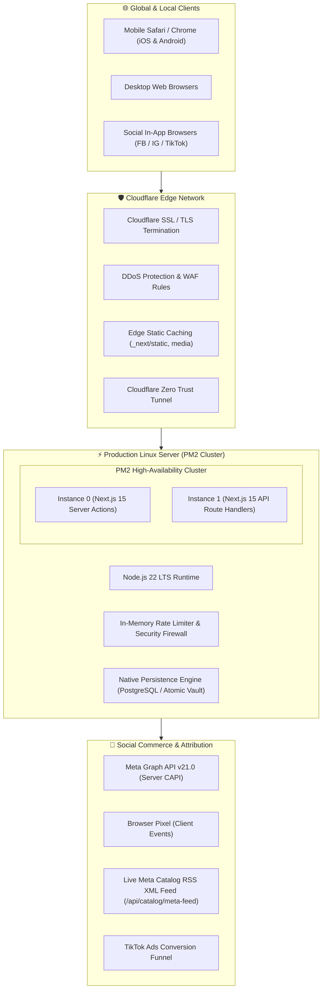

# 🏛️ LIFAZ Atelier — Luxury E-Commerce Platform
### Fullstack Engineering & Architectural Case Study

<div align="center">

[](https://lifaz.shop)
[-black?style=for-the-badge&logo=next.js&logoColor=white)](https://nextjs.org/)
[](https://react.dev/)
[](https://www.typescriptlang.org/)
[](https://tailwindcss.com/)
[](https://developers.facebook.com/docs/marketing-api/conversions-api/)
[](https://www.cloudflare.com/)

<br />

**A high-performance, mobile-first luxury fashion e-commerce platform engineered with a headless Next.js 15 App Router architecture, real-time social ad attribution (Meta CAPI & TikTok Pixel), in-house Atelier CMS, and zero-downtime Linux PM2 cluster.**

[Explore Live Production Store →](https://lifaz.shop)

</div>

---

## 📑 Table of Contents
- [Executive Summary](#-executive-summary)
- [System Architecture](#-system-architecture)
- [Technology Stack](#-technology-stack)
- [Key Engineering Achievements](#-key-engineering-achievements)
  - [1. Meta Conversions API (CAPI) & Ad Attribution Engine](#1-meta-conversions-api-capi--ad-attribution-engine)
  - [2. Mobile-First Luxury Editorial UX & Micro-Interactions](#2-mobile-first-luxury-editorial-ux--micro-interactions)
  - [3. Custom Atelier Admin CMS Studio](#3-custom-atelier-admin-cms-studio)
  - [4. Archive & Sold-Out Garment Handling](#4-archive--sold-out-garment-handling)
  - [5. 64-District Logistics & Payment Matrix](#5-64-district-logistics--payment-matrix)
- [DevOps & Infrastructure](#-devops--infrastructure)
- [Security & Performance Hardening](#-security--performance-hardening)
- [Live Storefront Walkthrough](#-live-storefront-walkthrough)
- [Author & Engineering Profile](#-author--engineering-profile)

---

## 🌟 Executive Summary

**LIFAZ Atelier** is an ultra-premium luxury ready-to-wear brand based in Dhaka, Bangladesh. To deliver a digital shopping experience matching luxury fashion houses while optimizing for high-volume social advertising (Meta & TikTok), the platform was engineered entirely from scratch without monolithic third-party e-commerce platforms.

### Core Objectives Delivered:
- ⚡ **Sub-100ms Response Times:** Server-rendered Next.js 15 pages with edge asset optimization via Cloudflare.
- 🎯 **Ad Tracking Resilience:** Hybrid Meta Pixel + Server-Side Conversions API (CAPI) with SHA-256 Event Match Quality (EMQ) deduplication.
- 🎨 **Editorial High-Fashion Aesthetic:** Bespoke typography (`Khy`), smooth Framer Motion page transitions, and portal-rendered drawers.
- 📊 **Unified In-House CMS:** Real-time catalog matrix, campaign hero/mosaic visual studios, and order tracking with 1-click thermal invoice printing.

---

## 📐 System Architecture



---

## 🛠️ Technology Stack

| Layer | Technologies | Architectural Rationale |
| :--- | :--- | :--- |
| **Frontend Framework** | **Next.js 15.5 (App Router)**, React 19, TypeScript | Server Components for instant initial paint, Client Components for dynamic cart & drawers. |
| **Styling & Motion** | **Tailwind CSS v4**, Framer Motion, Lucide Icons | Utility-first styling with zero runtime CSS overhead; fluid spring animations. |
| **State & Navigation** | React Context API, LocalStorage Vault, Next.js Navigation | Decoupled client-side cart drawer, instant route change progress bar. |
| **Ad Tracking & CAPI** | Meta CAPI (Graph API v21), SHA-256 Hashing, TikTok Events | Server-side conversion tracking bypassing iOS 14+ ad-blockers with event deduplication. |
| **Backend & Routing** | Next.js Server Actions & Route Handlers | Unified fullstack codebase with zero cold-start API latency. |
| **Database Engine** | PostgreSQL 17, Prisma ORM, Atomic Storage Engine | High-throughput relational data with automated snapshot backups. |
| **DevOps & Hosting** | Linux (Debian 13), PM2 Cluster Mode, Cloudflare Tunnels | 100% self-hosted, zero vendor lock-in, zero cloud database subscription fees. |

---

## 🚀 Key Engineering Achievements

### 1. Meta Conversions API (CAPI) & Ad Attribution Engine
- **Hybrid Tracking:** Dispatches conversion events (`ViewContent`, `AddToCart`, `InitiateCheckout`, `Purchase`) simultaneously via the browser Pixel and server-side CAPI.
- **Event Match Quality (EMQ):** Automatically cleanses, normalizes (lowercase, trim), and hashes customer metadata (phone, email, division, city) with **SHA-256** before sending to Meta Graph API v21.0.
- **Deduplication:** Pairs a unique cryptographic `event_id` across client and server calls to prevent double-counting conversions in Meta Ads Manager.
- **Dynamic Meta XML Catalog:** Built a real-time RSS 2.0 / Facebook XML endpoint (`/api/catalog/meta-feed`) enabling 1-click catalog sync for Meta Commerce Manager and Instagram Shopping.

### 2. Mobile-First Luxury Editorial UX & Micro-Interactions
- **Viewport-Adaptive Typography:** Custom line-height and letter-spacing system (`leading-[1.1]` on mobile, `leading-[0.95]` on desktop) with `text-balance` to prevent orphan words on small screens.
- **Portal-Rendered Drawers:** All interactive slide-outs (Cart Drawer, Filter Sidebar, Mobile Navigation) are rendered via `createPortal(..., document.body)` with hydration safety to prevent clipping from parent CSS `backdrop-filter` headers.
- **Native Touch Gestures:** Native `PullToRefresh` interaction for iOS/Android and an ultra-fast route progress bar (`TopRouteProgress`).

### 3. Custom Atelier Admin CMS Studio
- **Ad Analytics & Attribution Hub:** Parses UTM parameters (`utm_source`, `utm_campaign`, `utm_medium`) on live orders to report ad spend ROI, campaign conversion volumes, and regional order splits.
- **Visual Storefront Studios:**
  - *Hero Studio:* Live headline, button, and banner media customization.
  - *Mosaic Studio:* Grid layout curation for editorial campaign stories.
  - *Client-Side Compression:* Integrated HTML5 Canvas image compression (up to 2048px @ 85% WebP quality) to eliminate server payload size limit issues.
- **Order Printing Desk:** 1-click generation of POS thermal receipts and courier packing slips.

### 4. Archive & Sold-Out Garment Handling
- **Historical Runway Archive:** Allows displaying sold-out pieces from previous collection drops (2024–2025) on the storefront.
- **Visual Indicators:** Prominent `SOLD OUT // ARCHIVE` contrast badges, struck-through size selectors, and disabled checkout triggers.
- **VIP WhatsApp Bridge:** Seamlessly directs interested clients to the floating WhatsApp Concierge for custom made-to-measure inquiries.

### 5. 64-District Logistics & Payment Matrix
- **Bangladesh Division & District Engine:** Integrated logistics covering all 8 divisions and 64 districts with automated tiered shipping calculations:
  - Inside Dhaka Standard (24–48h): ৳80 (Free above ৳5,000 threshold)
  - Outside Dhaka Nationwide (2–3 days): ৳150 via Steadfast Courier
  - Same-Day VIP White-Glove Concierge: ৳250
- **Multi-Channel Payments:** Seamless support for Cash on Delivery (COD), bKash / Nagad Mobile Financial Services (MFS), and 3D-Secure Card channels.

---

## ⚡ DevOps & Infrastructure

```
┌─────────────────────────────────────────────────────────────┐
│                     PM2 CLUSTER STATUS                      │
├────┬──────────────────┬──────────┬────────┬─────────────────┤
│ ID │ Name             │ Mode     │ Status │ Memory Usage    │
├────┼──────────────────┼──────────┼────────┼─────────────────┤
│ 0  │ lifaz-atelier    │ cluster  │ online │ ~205 MB         │
│ 1  │ lifaz-atelier    │ cluster  │ online │ ~208 MB         │
└────┴──────────────────┴──────────┴────────┴─────────────────┘
```

- **Zero-Downtime Reloads:** Uses `pm2 reload` to cycle cluster instances one-by-one during updates with zero dropped client connections.
- **Cloudflare Zero Trust Tunnel:** Directly routes public requests from `lifaz.shop` to the local PM2 port without opening vulnerable public firewall ports.

---

## 🛡️ Security & Performance Hardening

1. **Sliding-Window IP Rate Limiter:**
   - Admin authentication: Max 5 attempts per 15 minutes.
   - Checkout order submission: Max 10 orders per 10 minutes per IP.
   - Public forms (Newsletter / Concierge): Max 6 submissions per minute.
2. **Input Sanitization:** Strips XSS vectors (`<script>`, `<iframe>`, `javascript:`) and guards against prototype pollution.
3. **HTTP Security Headers:**
   - `Content-Security-Policy` (CSP)
   - `X-Frame-Options: SAMEORIGIN`
   - `X-Content-Type-Options: nosniff`
   - `Referrer-Policy: strict-origin-when-cross-origin`
   - `Strict-Transport-Security (HSTS)`

---

## 📸 Live Storefront Walkthrough

| Feature | Description | Status |
| :--- | :--- | :--- |
| **Editorial Runway** | Dynamic campaign slider, drop countdown, and mosaic gallery | ✅ Live |
| **Product Detail (PDP)** | Multi-angle photo zoom, size blueprint guide, sticky add-to-bag | ✅ Live |
| **Cart & Quick Checkout** | Free delivery meter, instant coupon engine, courier selector | ✅ Live |
| **VIP WhatsApp Concierge** | Floating assistant with product-specific inquiry autofill | ✅ Live |
| **Atelier Admin Studio** | Stock matrix, CAPI attribution analytics, thermal print desk | ✅ Live |

---

## 🌐 Live Production Access

The store is deployed and live:  
🔗 **[https://lifaz.shop](https://lifaz.shop)**

---

## 👨‍💻 Author & Engineering Profile

**Fahad Rahman**  
- **Role:** Lead Fullstack Engineer & Founder  
- **GitHub:** [@fahadrahman444](https://github.com/fahadrahman444)  
- **Organization:** [@Neeroxa](https://github.com/Neeroxa)  
- **Live Platform:** [lifaz.shop](https://lifaz.shop)

---
<div align="center">
<sub>Engineered with precision for LIFAZ Atelier · © 2024–2026 All Rights Reserved</sub>
</div>
